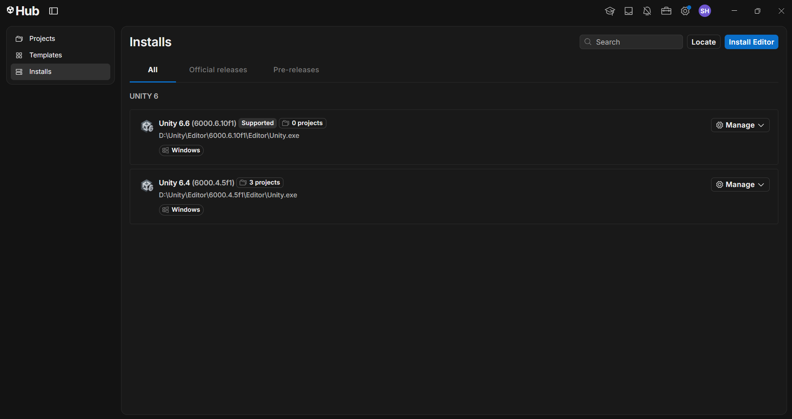
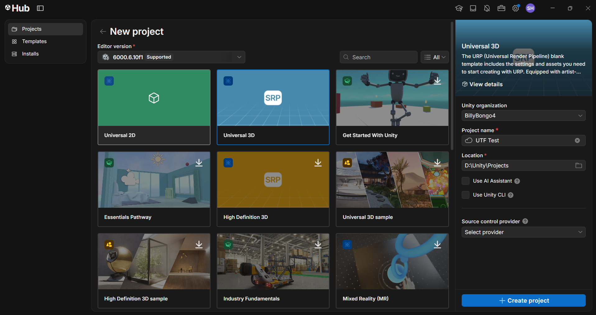
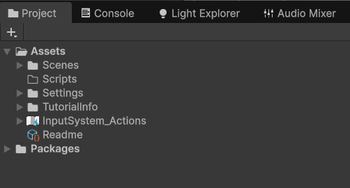
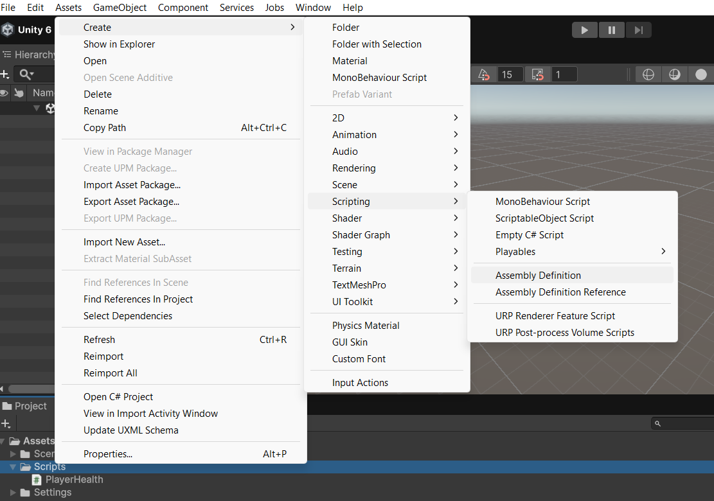
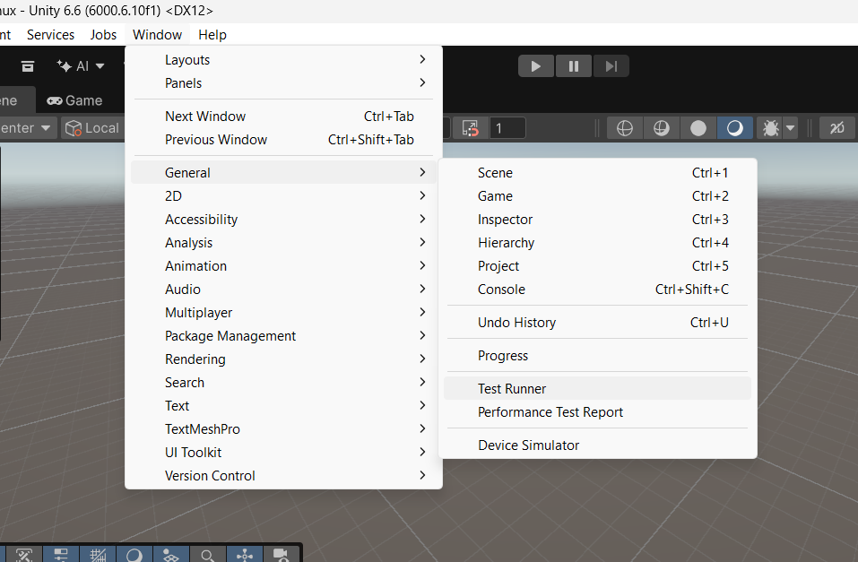
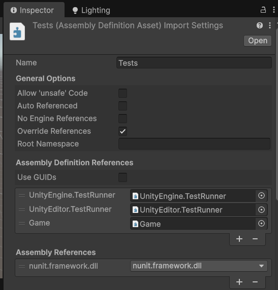
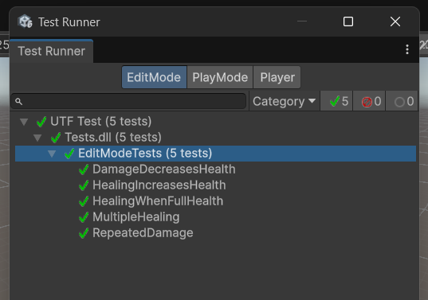
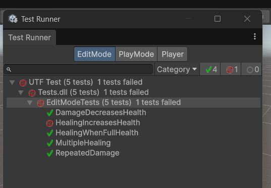
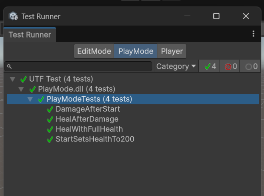
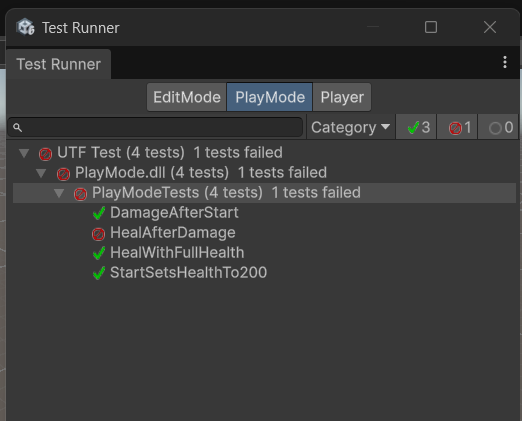

# Curiosity Report: Unity Test Framework

I've been using Unity for years. I'm even been using it to make a game currently. However, one thing that rarely gets talked about when it comes to Unity, even by the Unity company, is unit testing. Everyone focuses more on testing through gameplay instead. As a result, I was curious if Unity even had a way for doing automated testing. That is how I learned about Unity Test Framework.

## Overview

### What is the Unity Test Framework?

The Unity Test Framework (UTF) is a testing framework included with Unity that allows developers to write and run automated tests for their projects. The framework is built upon NUnit and extends its functionality to support Unity-specific features like GameObjects, coroutines, frame progression, and application lifecycle. Tests can be written for either Edit Mode or Play Mode. Edit Mode tests are intended for testing isolated code and game logic without running the game. Play Mode tests allow code to execute within Unity's runtime environment, making it possible to test features that depend on frames, and lifecycle mehtods such as `Start()` and `Update()`, and other engine behavior.

### Edit Mode vs Play Mode

| Edit Mode                                                        | Play Mode                                                                   |
| ---------------------------------------------------------------- | --------------------------------------------------------------------------- |
| Runs code inside the Editor                                      | Runs code when the game is playing, whether inside the Editor or standalone |
| Runs in the `EditorApplication.update` callback loop             | Runs as a coroutine                                                         |
| Can yield until the next iteration of `EditorApplication.update` | Can yield until the next iteration of the per-frame game update loop        |

### Benefits and Limitations

#### Benefits

- Included with Unity
- Supports both Edit Mode and Play Mode testing
- Play Mode tests can interact with Unity's runtime and frame-based loop

#### Limitations

- Requires correct assembly configuration
- Some NUnit features are not fully supported by the UnityTest attribute, such as parameterized tests and the Repeat attribute
- Platform-specific limitations exist for some testing scenarios

## Experiments

### Setup

1. Create a Unity account at https://unity.com/
2. Download and install Unity Hub at https://unity.com/download
3. Open Unity Hub
4. Go to the `Installs` tab on the left and if you don't already have one, install an editor
   
   - **Note:** For these experiments I will be using Unity 6.6 with no additional modules.
5. Return back to the `Projects` tab
6. Click on the blue `+ Create project` button on the top right corner
7. Select the `Universal 3D` option if it isn't selected by default
8. Give the project a name, e.g., `UTF Test`
   - **Note:** While typing the name, a box will drop down giving you the choice to choose between cloud and local for the project. This is easy to miss. For these experiments I went with local.



9. Click the blue `+ Create project`
10. Accept the software terms, if necessary
11. Once the project has loaded, switch the tab at the bottom from `Console` to `Project`
12. Inside the `Assets` folder, create a new folder by pressing the `+` and selecting the top option, `Folder`
13. Name the new folder `Scripts`

    

14. Press the `+` again, and this time choose `MonoBehaviour Script`
15. Name the new script something, like `PlayerHealth`
16. Inside the script, create a basic class, like this:

    ```csharp
    using UnityEngine;

    public class PlayerHealth : MonoBehaviour
    {
        public int health = 100;
        public int maxHealth = 100;

        private void Start()
        {
            health = 200;
            maxHealth = 200;
        }

        public void TakeDamage(int damage)
        {
            health -= damage;
        }

        public void Heal()
        {
            if (health < maxHealth) health += 5;
        }
    }

    ```

    - **Note:** Make sure your class is a subclass of `MonoBehaviour`, this will be very important later. The `Start` function is a built-in Unity lifecycle method that is automatically called once by the Unity runtime when a `MonoBehaviour` becomes active. This will come into play during the `Play Mode` tests.

17. Right click the `Scripts` folder, choose `Create` > `Scripting` > `Assembly Definition` and name it `Game`
    
    - **Note:** This is necessary for the tests to be able to access the `PlayerHealth` class we just made.
18. Next, select the `Assets` folder, which should highlight it blue
19. Press the `+` button and create a new folder
20. Name it `Tests`
21. Lastly, we need to open the `Test Runner` window by going to `Window` > `General` > `Test Runner`
    

### Experiment 1: Edit Mode

1. Select the `Tests` folder by left clicking it, which should highlight it blue
2. Make sure you are on the `Edit Mode` tab of the `Test Runner` window
3. In the `Test Runner` window, click on the `Create a new Test Assembly Folder in the active path.` button
4. Name the created folder something like `EditMode`, which will also create a new assembly file with the same name
5. Inside the newly created folder, click on the `EditMode` assembly file (it should have the same icon as the previously created `Game`)
6. Under the `Assembly Definition References` section, press the `+` to create a new slot, then drag and drop the `Game` assembly into the new slot
   
7. Select the `EditMode` folder, which should highlight it blue
8. Inside the `Test Runner` window, click the `Create a new Test Script in the active path.` button, which should be only option
9. Name the test script something like `EditModeTests`
10. Inside the new script there is a starting point which can be built off of and expanded, so create a suite a tests for `PlayerHealth` such as this:
    - Some things to know:
      - Edit Mode tests primarily use NUnit for writing tests, but it is still managed through the UTF.
      - `[Setup]` -- NUnit's equivalent to `beforeEach`.
      - `[Teardown]` -- NUnit's equivalent to `afterEach`.
      - `[Test]` -- The attribute that identifies a function as a test.
      - `gameObject.AddComponent<PlayerHealth>();` -- Since Unity uses a component system, `MonoBehaviour` classes must be added as components to game objects.

    ```csharp
    using NUnit.Framework;
    using UnityEngine;

    public class EditModeTests
    {
        private GameObject gameObject;
        private PlayerHealth playerHealth;

        [SetUp]
        public void SetUp()
        {
            gameObject = new GameObject();
            playerHealth = gameObject.AddComponent<PlayerHealth>();
        }

        [TearDown]
        public void CleanUp()
        {
            GameObject.DestroyImmediate(gameObject);
        }

        [Test]
        public void DamageDecreasesHealth()
        {
            playerHealth.TakeDamage(25);

            Assert.AreEqual(75, playerHealth.health);
        }

        [Test]
        public void RepeatedDamage()
        {
            playerHealth.TakeDamage(25);
            playerHealth.TakeDamage(50);

            Assert.AreEqual(25, playerHealth.health);
            Assert.AreNotEqual(50, playerHealth.health);
            Assert.AreNotEqual(75, playerHealth.health);
        }

        [Test]
        public void HealingIncreasesHealth()
        {
            playerHealth.TakeDamage(25);
            playerHealth.Heal();

            Assert.AreEqual(80, playerHealth.health);
        }

        [Test]
        public void MultipleHealing()
        {
            playerHealth.TakeDamage(25);
            playerHealth.Heal();
            playerHealth.Heal();

            Assert.AreEqual(85, playerHealth.health);
            Assert.AreNotEqual(80, playerHealth.health);
            Assert.AreNotEqual(90, playerHealth.health);
        }

        [Test]
        public void HealingWhenFullHealth()
        {
            playerHealth.Heal();

            Assert.AreNotEqual(105, playerHealth.health);
        }
    }

    ```

11. Return back to the `Test Runner` window and the tests you have created should be listed
12. Click on the `Run All` button at the bottom right and you should get something like:

    

13. Now, to ensure that the tests are actually working, we will purposely break them, such as commenting out the `playerHealth.TakeDamage()` in `HealingIncreasesHealth` to get something like:

    

14. Fix the tests, and then we are done

### Experiment 2: Play Mode

1.  Select the `Tests` folder
2.  Switch to the `Play Mode` tab in the `Test Runner` window
3.  Click on the `Create a new Test Assembly Folder in the active path.` button
4.  Name the created folder something like `PlayMode`, which will also create a new assembly file with the same name
5.  Inside the newly created folder, click on the `PlayMode` assembly file (it should have the same icon as the previously created `Game`)
6.  Under the `Assembly Definition References` section, press the `+` to create a new slot, then drag and drop the `Game` assembly into the new slot, just as you did for `Edit Mode`
7.  Select the `EditMode` folder
8.  Click the `Create a new Test Script in the active path.` button
9.  Name it something like `PlayModeTests`
10. Inside `PlayModeTests` write another suite of tests
    - Some things to know: - `[UnityTest]` -- Unlike `[Test]`, `[UnityTest]` hooks into the runtime loop of Unity, which allows for tests to run through multiple frames. As a result every test has to be a coroutine, with a return type of `IEnumerator`.

    ```csharp
    using NUnit.Framework;
    using System.Collections;
    using UnityEngine;
    using UnityEngine.TestTools;

    public class PlayModeTests
    {
        private GameObject gameObject;
        private PlayerHealth playerHealth;

        [SetUp]
        public void SetUp()
        {
            gameObject = new GameObject();
            playerHealth = gameObject.AddComponent<PlayerHealth>();
        }

        [TearDown]
        public void CleanUp()
        {
            Object.DestroyImmediate(gameObject);
        }

        [UnityTest]
        public IEnumerator StartSetsHealthTo200()
        {
            yield return null;

            Assert.AreEqual(200, playerHealth.health);
        }

        [UnityTest]
        public IEnumerator DamageAfterStart()
        {
            yield return null;

            playerHealth.TakeDamage(25);

            Assert.AreNotEqual(75, playerHealth.health);
            Assert.AreEqual(175, playerHealth.health);
        }

        [UnityTest]
        public IEnumerator HealAfterDamage()
        {
            yield return null;

            playerHealth.TakeDamage(25);
            playerHealth.Heal();

            Assert.AreNotEqual(80, playerHealth.health);
            Assert.AreEqual(180, playerHealth.health);
        }

        [UnityTest]
        public IEnumerator HealWithFullHealth()
        {
            yield return null;

            playerHealth.Heal();

            Assert.AreNotEqual(205, playerHealth.health);
            Assert.AreNotEqual(105, playerHealth.health);
            Assert.AreEqual(200, playerHealth.health);
        }
    }

    ```

11. Return back to the `Test Runner` window and the tests should appear now
12. Click `Run All` at the bottom of the `Test Runner` window and you should get something like:

    

13. Now to make sure the tests are actually working, we will purposely break them, such as commenting out `playerHealth.Heal();` in `HealAfterDamage`, which gives us:

    

14. Fix the tests and run again to make sure they all work again
15. Now we are done!

## Conclusion

After completing the experiments, I would say that it's quite good over all. However, there are a lot of steps for setting it up, especially if it's your first time. And the documentation isn't the best or most comprehensive, so there were some complications as I learned how to use it. This resulted in the learning process taking much longer than I thought it would. Fortunately, once it's set up it's very easy to use and provides almost all of the necessary functionality one would want unit testing for a video game. And the fact that it comes included with the default installation of Unity also makes it convenient.

## References

https://docs.unity3d.com/Packages/com.unity.test-framework@2.0/manual/index.html#sidetoggle

https://docs.unity.com/en-us/engine/6000.6/manual/programming-environment/test-framework-introduction

https://docs.unity.com/en-us/engine/6000.6/manual/programming-environment/test-framework-introduction/overview/general-introduction

https://docs.unity.com/en-us/engine/6000.6/manual/programming-environment/test-framework-introduction/overview/general-introduction/play-mode-tests

https://docs.unity.com/en-us/engine/6000.6/manual/programming-environment/test-framework-introduction/overview/general-introduction/unitytest-attribute

https://docs.unity.com/en-us/engine/6000.6/manual/programming-environment/test-framework-introduction/writing-tests

https://docs.unity.com/en-us/engine/6000.6/manual/programming-environment/test-framework-introduction/writing-tests/before-and-after-tests/reference-unitysetup-and-unityteardown
